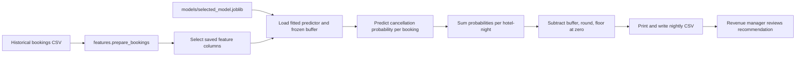

# What exactly are we building, and why this way?

**Owner:** Build Lead. **Status:** MVP requirements draft; model selection and proof-period figures await the Model Lead.

## 1. Who uses it, when, and what do they do with it?

The revenue manager uses a command-line tool to review a recommendation for each hotel and arrival night in a requested date range. The required demonstration is 14 nights beginning 18 August 2017. The manager uses the oversell count as a decision aid; this MVP does not place bookings or change the hotel's reservation system.

The course data contains the final book for historical nights. It does not represent a live snapshot of the bookings known on a real morning. The demonstration therefore proves the calculation and output format, not a live 14-day forecast.

## 2. Which ways could we decide, and what would make us choose one?

We compare the client's flat hotel cancellation-rate rule, a lookup rule, and at least two learned models. The Model Lead fits methods on the train period and chooses each method's buffer using the choose period. The chosen method must meet the ceiling of 10 walked guests per 1,000 arrivals on choose; among feasible candidates, select the lowest-cost option on choose. Run proof once after choices are frozen.

The MVP will load the method saved by `src/backtest.py`; it will not retrain. The actual winning method and the condition that would make the team switch to another feasible method remain pending the Model Lead's backtest. If no candidate meets the ceiling on choose, the safe fallback is to oversell zero rooms and report that the candidate methods failed the acceptance rule.

## 3. What is our answer to the wish-list item?

Hidden guest types are outside the MVP. Clustering could describe groups of bookings, but it does not directly decide how many rooms to oversell on a hotel-night. No clustering experiment has shown a change to the number the manager would act on; the measured change is therefore **0 demonstrated rooms**. Revisit clustering only if a later experiment shows lower choose-period cost while respecting the walk ceiling.

## 4. What exactly is in the table the client reads?

One row per hotel and arrival night, with:

| Column | Meaning |
|---|---|
| `hotel` | City Hotel or Resort Hotel |
| `arrival_date` | Arrival night |
| `book` | Number of bookings in the supplied file for that hotel-night |
| `expected` | Sum of predicted cancellation probabilities for those bookings |
| `buffer` | Frozen safety buffer, expressed in rooms for this night |
| `oversell` | Non-negative whole-room recommendation after subtracting the buffer |
| `reason` | Short explanation of the expected cancellations and buffer used |

The command writes a CSV and prints the same table. Missing hotel-nights in the requested period appear with zero bookings and zero oversell.

## 5. Which inputs do we use, by bin?

The current team-approved feature list has 17 fields. Per `docs/COLUMNS.md`, its timing is 9 Bin 1 fields (`hotel`, `market_segment`, `distribution_channel`, `is_repeated_guest`, `previous_cancellations`, `previous_bookings_not_canceled`, `agent`, `company`, `customer_type`), 7 Bin 2 fields (`lead_time`, the four arrival-date parts, `meal`, `reserved_room_type`), and 1 Bin 3 field (`country`). The team has recorded that it accepts this timing risk. It must not be described as a booking-time-only feature set; this remains a rubric and deployment risk.

`is_canceled` is the target, never a model input. `adr`, `nights`, and the derived `arrival_date` support filtering, grouping, or the client scoring contract; they are not model inputs. The selected model artifact must state its exact feature list. The command rejects an artifact that requests fields outside `features.MODEL_FEATURES` or includes the target/scoring fields.

The historical source file includes cancellation outcomes. The nightly recommendation code uses the outcome only as a required part of the current shared cleaning interface; it excludes it from the model matrix and does not use it to calculate expected cancellations or oversell. A live booking export without the outcome column will require the Data Lead to provide a target-free inference preparation function before production use.

## 6. Where do the numbers come from, and how is the buffer set and frozen?

The fitted predictor gives one cancellation probability per booking. The command sums those probabilities by hotel and arrival night. The buffer was selected on the choose period, then saved with the fitted predictor. It may be a fixed number of rooms or a multiplier of the nightly cancellation spread; the saved artifact records which kind it is and its value. The recommendation is `max(0, round(expected - buffer))`, as a whole number.

Integration contract for `models/selected_model.joblib`:

```python
{
    "predictor": fitted_pipeline,  # exposes predict_proba(X)[:, 1]
    "feature_columns": [...],     # ordered input columns used to fit it
    "method": "method name",
    "buffer": {"kind": "rooms", "value": 2.0},
    # or {"kind": "spread_multiplier", "value": 1.0}
}
```

The pipeline must include any fitted preprocessing, so inference applies the same encoding as training. The Model Lead owns writing this artifact from `src/backtest.py`; the Build Lead owns reading it from `src/nightly.py`.

## 7. What is the error bill on the proof period?

These figures are intentionally pending until the Model Lead runs `python src/backtest.py` using the frozen settings and the project scoring contract.

| Rule | Empty rooms | Walked guests | Walks per 1,000 | Cost (EUR) | Monthly saving vs flat rule (EUR) |
|---|---:|---:|---:|---:|---:|
| Client's flat rule | Pending | Pending | Pending | Pending | 0 |
| Selected rule | Pending | Pending | Pending | Pending | Pending |

Every comparison must state the filtered scoring population recorded in `docs/DECISIONS.md`. Costs from different populations are not directly comparable.

## 8. What does the system look like?



The diagram is also saved as `docs/architecture.svg`. It describes the historical-data MVP. A production input snapshot, which may not include `is_canceled`, is not implemented yet.

## 9. What are the limits?

- The source is historical data for two anonymized Portuguese hotels, not a live hotel-system feed.
- The nightly command demonstrates requested historical dates; it does not model which reservations are on the book at a real future decision time.
- The accepted 17-feature list includes Bin 2 and Bin 3 fields. It is not safe to claim booking-time-only performance.
- The approved cleaning filters remove 827 rows before scoring. Results apply to that logged population, not all 119,390 source rows.
- No room-capacity field is present. The tool outputs an oversell count, not a capacity or total-inventory recommendation.
- Method, buffer, proof costs, AUCs, and walk rate are pending the Model Lead's completed backtest.

## 10. What could go wrong?

- A saved model may expect a different feature order or preprocessing. The command validates the feature list and requires a fitted pipeline.
- The model or buffer may be missing or malformed. The command stops with an actionable error rather than silently using a default.
- Cancellation patterns may shift by season or hotel. The team must report proof-period results and monitor performance before any live use.
- The walk ceiling is a portfolio-level evaluation rule; individual nights can still have walks. The output is a recommendation, not a guarantee.
- The timing risk in the 17-column list can make apparent performance unavailable at the real decision time. Resolve this before production.
- The full-book historical evaluation overstates how much inventory is known 14 days ahead; the current booking-snapshot gap is a roadmap item.

## 11. What is out of scope?

The MVP does not connect to a property-management system, place or cancel reservations, expose a web interface, discover guest clusters, estimate hotel capacity, or retrain itself. It produces a reviewable CSV recommendation from the supplied bookings file and a committed fitted model artifact.
